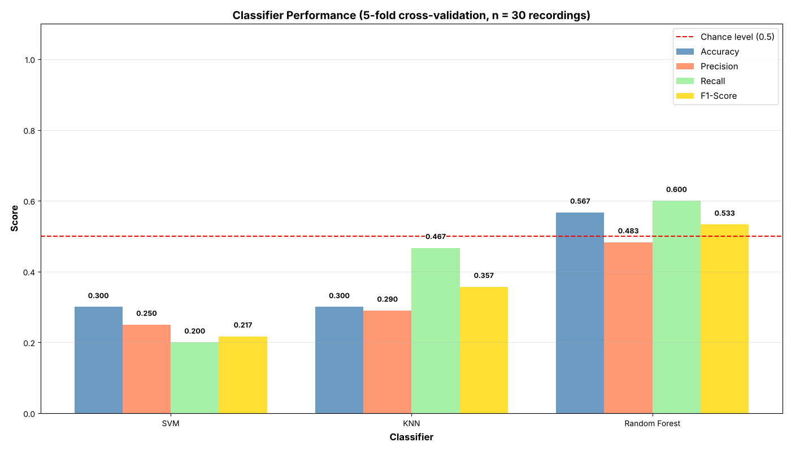
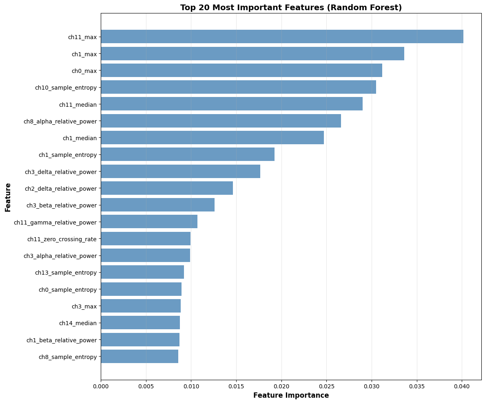
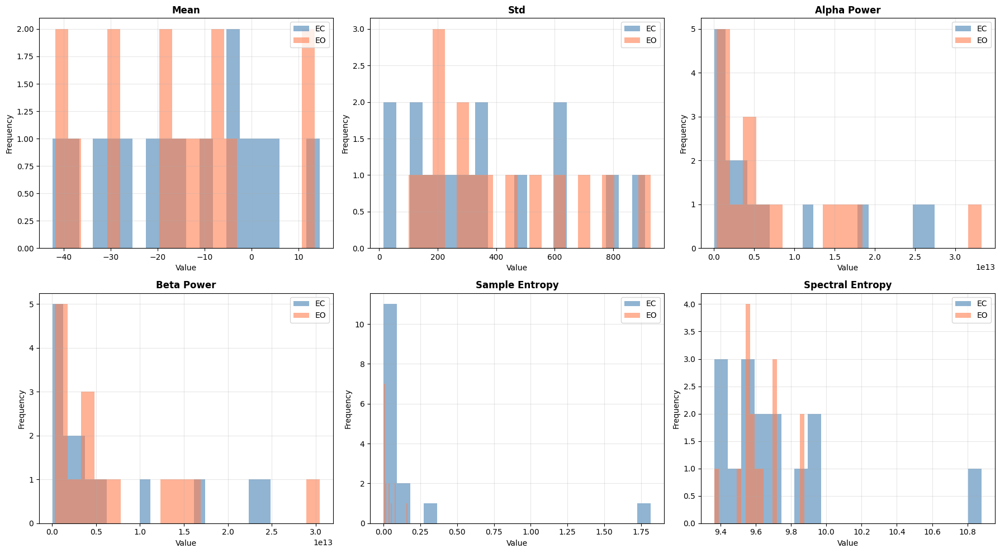

# EEG Classification with Machine Learning — Predicting Eye State (Open / Closed)

My **MSc Data Analytics dissertation**: a pipeline that tries to classify **eye state (eyes open vs. eyes closed)** from resting-state EEG using classical machine learning. It covers feature engineering across frequency bands, a comparison of three classifiers, and an honest look at why the classifiers did not generalise on a small sample.

> MSc Data Analytics — Dissertation. Author: Amin Behzadnia, 2026.

## Overview

Alpha power is known to rise when the eyes close. This project tests whether that difference can be picked up by machine learning on a small, real-world EEG sample rather than a large public benchmark.

- **Data:** primary resting-state EEG (eyes open and eyes closed) from 15 healthy participants, which I recorded during my earlier MSc Electronic Engineering research and reused here (not a public dataset).
- **Channels:** 19 channels, 10–20 system, sampled at 256 Hz.
- **Features (475 in total):** per-channel time-domain statistics (mean, SD, skewness, kurtosis, RMS, zero-crossing rate), absolute and relative band power (delta to gamma), spectral entropy and sample entropy.
- **Models:** Support Vector Machine, k-Nearest Neighbours and Random Forest, evaluated with 5-fold stratified cross-validation. PCA is used for visualisation.

## Pipeline

The analysis is in [`notebooks/eeg_analysis_pipeline.ipynb`](notebooks/eeg_analysis_pipeline.ipynb):
data loading → feature extraction → visualisation → PCA → cross-validated classification → feature importance → univariate statistics.

The notebook works directly on the exported recordings; filtering and artefact correction are not part of it.

## Results

**Cross-validated performance (5-fold, 30 recordings):**

| Classifier | Accuracy | Precision | Recall | F1-score |
|------------|:--------:|:---------:|:------:|:--------:|
| SVM | 0.30 | 0.25 | 0.20 | 0.22 |
| KNN | 0.30 | 0.29 | 0.47 | 0.36 |
| Random Forest | 0.57 | 0.48 | 0.60 | 0.53 |



**How to read these numbers.** Chance level for this balanced two-class problem is 50%. SVM and KNN scored below chance and Random Forest was close to it, so none of the models classified eye state reliably. With only 6 recordings per test fold, one error shifts accuracy by about 17 percentage points, which is why the estimates are so unstable. The Random Forest reaches 100% accuracy when tested on its own training data, which shows overfitting rather than real performance.

**Why it didn't work:**

- **Far more features than samples** (475 features vs 30 recordings), so the models fit noise.
- **Folds were not grouped by participant**, so the two recordings from one person could be split between training and test sets.
- **No artefact handling in this pipeline.** The top-ranked features were channel maxima, which are sensitive to artefacts rather than to alpha activity.



**What I would do differently:** leave-one-subject-out cross-validation, a small set of a-priori features (e.g. posterior alpha power), artefact correction before feature extraction, and a permutation test to check performance against chance.

**Feature distributions — eyes closed (EC) vs eyes open (EO), channel 0 only:**



These histograms show a single channel (the first in the montage), not the posterior channels where the eyes-closed alpha increase is strongest. Absolute alpha and beta power are summed FFT power without normalisation, so they also scale with recording length (about 53,000 to 81,000 samples here) and are not directly comparable across recordings; relative band power avoids this. The "Mean" panel reflects the signal's DC offset rather than brain activity.

## Tech Stack

| Area | Tools |
|------|-------|
| Features | NumPy, SciPy, antropy (sample entropy) |
| Machine learning | scikit-learn (SVM, KNN, Random Forest, PCA, cross-validation) |
| Visualisation | Matplotlib, Seaborn |

## Repository Structure

```
EEG-Classification-ML/
├── README.md
├── notebooks/
│   └── eeg_analysis_pipeline.ipynb   # Full analysis
└── images/                           # Result figures (shown above)
```

## How to Run

```bash
pip install antropy scikit-learn scipy numpy pandas matplotlib seaborn jupyter
jupyter notebook
```

The raw EEG recordings are not included, to protect participant privacy. The notebook expects anonymised files in `data/sub-XX/sub-XX-EC.txt` and `data/sub-XX/sub-XX-EO.txt`.

## Notes

This is academic work submitted as my MSc dissertation and shared as part of my data analytics portfolio.
The full dissertation text is available on request.
